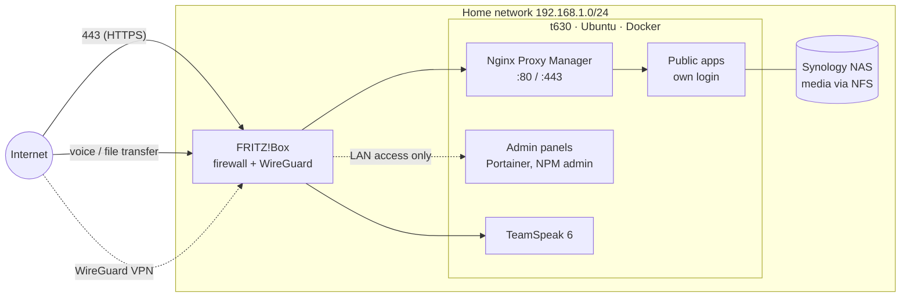

# homelab

Infrastructure as code for my self-hosted homelab: a single HP t630 thin client
that runs ~20 Docker services for media, home automation and a few personal tools.

The goal of this repo is to turn a setup that grew organically ("one more
`docker run` script…") into something documented, reproducible and secured the
way it would be in a professional environment — and to learn DevOps along the way.

> **Status:** work in progress. Documentation and CI come first; the services are
> being migrated from hand-written `docker run` scripts to Compose stacks one by one.
> See [TASK.md](TASK.md) for the current state.

## Hardware

| Component | Details |
|---|---|
| Host | HP t630 thin client, AMD GX-420GI (4 cores, 2 GHz), Radeon R7E iGPU |
| RAM | 8 GB (≈6.7 GB usable) |
| Storage | 256 GB SATA SSD (OS + Docker), media on a Synology NAS via NFS |
| OS | Ubuntu Server 22.04 LTS, Docker 28 + Compose v2 |
| Network | FRITZ!Box router (perimeter firewall, WireGuard VPN) |

## Architecture



**Access rules** (details in [docs/network.md](docs/network.md)):

1. **Web apps** are only reachable through Nginx Proxy Manager with HTTPS, and every
   public app must have its own login.
2. **Admin panels** (Portainer, NPM admin) have no public hostname at all — they are
   reachable from the LAN or through the FRITZ!Box WireGuard VPN only.
3. **Non-HTTP services** (TeamSpeak) get a direct port forward, nothing else does.
4. **SSH** is LAN/VPN-only and accepts hardware-backed FIDO2 keys (YubiKey) only.

## Services

| Service | Purpose | Access |
|---|---|---|
| Nginx Proxy Manager | Reverse proxy, Let's Encrypt certificates | Public :443 · admin UI LAN/VPN |
| Portainer | Docker management UI | LAN/VPN |
| Jellyfin | Media server | Public via NPM |
| Vaultwarden | Password manager (Bitwarden-compatible) | Public via NPM |
| Sonarr / Radarr / SABnzbd | Media automation ([stack](stacks/arr)) | Via NPM, app login |
| Frigate + go2rtc | NVR / camera streaming (grow tent cam) | LAN, see notes |
| GrowLog | My own grow-journal web app ([repo](https://github.com/iGridZ/Growlog)) | Public via NPM |
| vivosun-fetcher | Feeds camera credentials into go2rtc | Internal |
| changedetection.io | Website change monitoring ([stack](stacks/changedetection)) | LAN/VPN |
| Crafty | Minecraft server controller | LAN/VPN |
| TeamSpeak 6 | Voice server | Public (direct port forward) |
| Beszel + agent | Lightweight host/container monitoring ([stack](stacks/beszel)) | LAN |
| cloudflare-ddns | Keeps DNS records pointed at the home IP ([stack](stacks/cloudflare-ddns)) | Internal |
| autoheal | Restarts unhealthy containers ([stack](stacks/autoheal)) | Internal |

## Repository layout

```
.
├── docs/
│   ├── threat-model.md      # what is protected, from whom, attack surface
│   ├── network.md           # ports, Docker networks, access matrix
│   ├── decisions/           # architecture decision records (ADRs)
│   └── runbooks/            # step-by-step operational procedures
├── scripts/
│   └── inventory.sh         # read-only snapshot of the host (redacts secrets)
├── stacks/                  # one folder per service: compose.yaml + run.sh + .env.example
├── .github/workflows/ci.yml # lint + validation on every push / PR
└── TASK.md                  # open / done work items
```

## CI/CD

Every push and pull request runs:

- **shellcheck** – static analysis of all shell scripts
- **yamllint** – style/syntax of all YAML (Compose files, workflows)
- **docker compose config** – validates every stack's Compose file
- **gitleaks** – fails the build if a secret is committed

Planned: a self-hosted GitHub Actions runner on the host that deploys changed
stacks after a merge to `main` (see [TASK.md](TASK.md)).

## Git workflow

`feature/*` branches → pull request into `dev` → `dev` is merged into `main` after
review. `main` always reflects what is (or is about to be) running on the host.

## Security

The full reasoning lives in [docs/threat-model.md](docs/threat-model.md) and the
[decision records](docs/decisions/). Highlights:

- Minimal perimeter: only a handful of port forwards, each documented in
  [docs/network.md](docs/network.md) with its reason
- Admin interfaces never get a public hostname
- SSH with FIDO2 hardware keys only, no passwords, no root login
- Secrets live in untracked `.env` files on the host; CI blocks accidental commits
