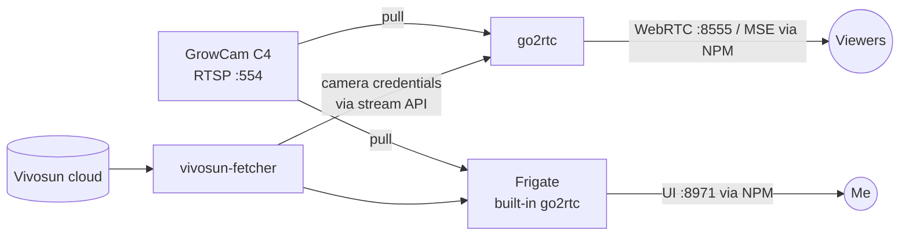

# camera

Grow tent camera (VIVOSUN GrowCam C4): live streaming, recording and the public viewer.

| | |
|---|---|
| Containers | `go2rtc`, `frigate`, `vivosun-fetcher` |
| Access | Frigate: `frigate.<domain>` (login, port 8971 via NPM) · viewer: `onlyplants.<domain>/stream.html?src=growcam` |
| Data | configs `/docker/config/go2rtc`, `/docker/config/frigate` (incl. `frigate.db`), recordings `/home/rock/media` |
| Secrets | Vivosun login in `.env`; camera RTSP credentials only in the configs on the host |



## Notes

- **go2rtc runs without `privileged`** and with all capabilities dropped. Its config
  only relays RTSP; nothing needs host hardware.
- **Only port 8555/tcp is published** (WebRTC, forwarded by the router). The go2rtc API
  (1984), RTSP outputs (8554/8556) and Frigate's UI (8971) are reachable on the Docker
  network only. Frigate pulls the camera through its *own* go2rtc on `127.0.0.1:8554`.
- The public viewer goes through NPM with a path filter, see `docs/network.md`.
- `vivosun-fetcher` is my own image, built by GitHub Actions in
  [iGridZ/vivosun-fetcher](https://github.com/iGridZ/vivosun-fetcher).
- Configs with camera credentials stay on the host and are not part of this repo.

## Deploy

Back up configs and the Frigate database first:

```bash
sudo cp -a /docker/config/frigate /docker/config/frigate.bak-$(date +%F)
sudo cp -a /docker/config/go2rtc  /docker/config/go2rtc.bak-$(date +%F)
cd ~/homelab/stacks/camera
cp .env.example .env && chmod 600 .env && nano .env   # first time only
docker rm -f vivosun-fetcher frigate go2rtc
docker compose up -d
docker compose logs -f vivosun-fetcher   # expect "OK - stream 'growcam' updated on …" twice
```

Checks: Frigate UI shows the live image, `onlyplants` viewer plays, GrowView works.

CLI alternative: `./run.sh`
