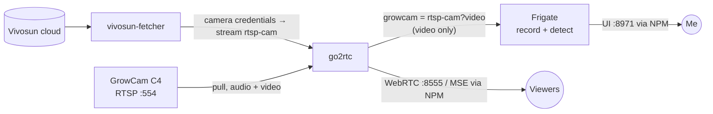

# camera

Grow tent camera (VIVOSUN GrowCam C4): live streaming, recording and the public viewer.

| | |
|---|---|
| Containers | `go2rtc`, `frigate`, `vivosun-fetcher` |
| Access | Frigate: `frigate.<domain>` (login, port 8971 via NPM) · viewer: `onlyplants.<domain>/stream.html?src=growcam` |
| Data | configs `/docker/config/go2rtc`, `/docker/config/frigate` (incl. `frigate.db`), recordings `/home/rock/media` |
| Secrets | Vivosun login in `.env`; camera RTSP credentials only in the configs on the host |



## Notes

- **go2rtc runs without `privileged`** and with all capabilities dropped. Its config
  only relays RTSP; nothing needs host hardware.
- **One source for the camera:** the fetcher writes the credentials only into go2rtc
  (stream `rtsp-cam`). `growcam` is derived from it without audio, and Frigate pulls
  `growcam` from go2rtc. Neither Frigate's config nor `growcam` contain the camera
  password.
- **Only port 8555/tcp is published** (WebRTC, forwarded by the router). The go2rtc API
  (1984), RTSP output (8554) and Frigate's UI (8971) are reachable on the Docker
  network only.
- The public viewer goes through NPM with a path filter, see `docs/network.md`.
- `vivosun-fetcher` is my own image, built by GitHub Actions in
  [iGridZ/vivosun-fetcher](https://github.com/iGridZ/vivosun-fetcher).
- Configs with camera credentials stay on the host and are not part of this repo.

## Stream layout (configs on the host)

`/docker/config/go2rtc/go2rtc.yaml`:

```yaml
streams:
  rtsp-cam:                 # main stream, credentials kept fresh by vivosun-fetcher
    - rtsp://<user>:<pass>@192.168.1.88:554/cam/realmonitor?channel=1&subtype=0
  rtsp-sub:                 # sub stream
    - rtsp://<user>:<pass>@192.168.1.88:554/h264/ch1/sub/av_stream
  growcam:                  # main, video only
    - rtsp://127.0.0.1:8554/rtsp-cam?video
  growcam_sub:              # sub, video only
    - rtsp://127.0.0.1:8554/rtsp-sub?video
```

`/docker/config/frigate/config.yaml` (Frigate's built-in go2rtc pulls from go2rtc):

```yaml
go2rtc:
  streams:
    growcam:
      - rtsp://go2rtc:8554/growcam
```

The camera input stays `rtsp://127.0.0.1:8554/growcam`.

## Deploy

Back up configs and the Frigate database first:

```bash
sudo cp -a /docker/config/frigate /docker/config/frigate.bak-$(date +%F)
sudo cp -a /docker/config/go2rtc  /docker/config/go2rtc.bak-$(date +%F)
cd ~/homelab/stacks/camera
cp .env.example .env && chmod 600 .env && nano .env   # first time only
docker rm -f vivosun-fetcher frigate go2rtc
docker compose up -d
docker compose logs -f vivosun-fetcher   # expect "OK - stream 'rtsp-cam' updated on http://go2rtc:1984"
```

Checks: Frigate UI shows the live image, `onlyplants` viewer plays, GrowView works.

CLI alternative: `./run.sh`
