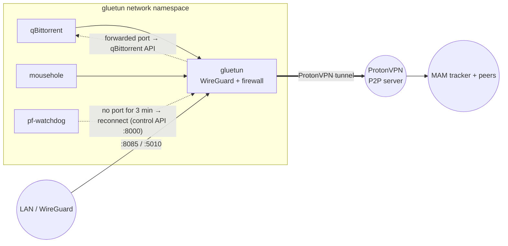

# torrent

Torrent client for MyAnonamouse (MAM), fully behind ProtonVPN.

| Container | Role |
|---|---|
| `gluetun` | ProtonVPN (WireGuard), kill-switch firewall, port forwarding (NAT-PMP) |
| `qbittorrent` | qBittorrent 5.2.3 with libtorrent v1, runs inside gluetun's network |
| `mousehole` | Keeps the MAM dynamic-seedbox IP up to date, also inside gluetun's network |
| `pf-watchdog` | Reconnects the VPN (new server) when port forwarding is lost for ~3 min |

| | |
|---|---|
| Access | qBittorrent `http://192.168.1.245:8085`, mousehole `http://192.168.1.245:5010` – LAN/VPN only |
| Data | `/media/share/mam` (NAS, NFS) → `/data/mam` in qBittorrent |
| Config | `/docker/configs/gluetun`, `/docker/configs/qbittorrent`, volume `mousehole` |
| Secrets | Proton WireGuard key, mousehole password, gluetun API key in `.env`; API key also in `/docker/configs/gluetun/auth/config.toml` |



## Why it is built like this

- **One IP for MAM.** qBittorrent and mousehole use `network_mode: service:gluetun`,
  so the tracker and the dynamic-seedbox API always see the same VPN IP.
- **Connectable.** gluetun gets a forwarded port from ProtonVPN and sets it as
  qBittorrent's listen port via the API (up command), binding qBittorrent to the VPN
  interface. On reconnect the new port is set automatically.
- **No leaks.** If the VPN is down, gluetun's firewall blocks all traffic.
- **libtorrent v1:** lower RAM use and more reliable when seeding from NFS than v2.
- **Web UI port 8085 on both sides.** qBittorrent's CSRF check compares the browser's
  port with its own; a mapping like `8085:8080` answers every request with
  `Unauthorized`. `WEBUI_PORT`, the port mapping and the gluetun up/down command
  must all use the same port.
- **mousehole Host allowlist.** mousehole only answers requests whose `Host` header
  is in `MOUSEHOLE_ALLOWED_HOSTS` (default: localhost). The LAN IP is added so the
  UI works at `192.168.1.245:5010`.

- **Port-forwarding watchdog.** ProtonVPN's NAT-PMP service on a server sometimes stops
  answering (`10.2.0.1:5351 … connection refused / i/o timeout`). Gluetun then retries
  on the same server forever and the client is not connectable. `pf-watchdog` asks
  gluetun's control API for the forwarded port every minute; after 3 misses it stops and
  starts the VPN, so gluetun picks a server from the pool again. This happens inside
  gluetun: qBittorrent and mousehole keep running. Restarting the gluetun *container*
  instead would cut them off the network until they are restarted too.
- **Relaxed gluetun healthcheck.** autoheal watches every container. With the image
  default (unhealthy after one failed check) it would restart gluetun during a short VPN
  reconnect. 10 s × 18 retries = only a 3 min outage counts.
- **Server pool.** `PROTON_SERVER_COUNTRIES` lists several countries, so a reconnect
  can land on another server.
- The `ERROR … setPreferences … [1]` lines in gluetun's log are wget's normal success
  output on stderr, not errors.

## First setup

1. NAS: create `media/mam`. Host: add to `/etc/fstab` and mount
   `192.168.1.250:/volume1/media/mam /media/share/mam nfs rw,vers=3,_netdev,nofail 0 0`
2. ProtonVPN: WireGuard config with **NAT-PMP (Port Forwarding)**, P2P server → copy the private key
3. `cp .env.example .env && chmod 600 .env`, fill in
4. gluetun control API key for `pf-watchdog` (same key in `.env` as `GLUETUN_API_KEY`):

   ```bash
   KEY=$(docker run --rm qmcgaw/gluetun:v3.41.3 genkey)
   sudo mkdir -p /docker/configs/gluetun/auth
   printf '[[roles]]\nname = "pf-watchdog"\nroutes = ["GET /v1/portforward", "PUT /v1/vpn/status"]\nauth = "apikey"\napikey = "%s"\n' "$KEY" \
     | sudo tee /docker/configs/gluetun/auth/config.toml >/dev/null
   sudo chmod 600 /docker/configs/gluetun/auth/config.toml
   sed -i "s|^GLUETUN_API_KEY=.*|GLUETUN_API_KEY=$KEY|" .env
   ```
5. `docker compose up -d`
6. qBittorrent (`:8085`): log in with the temporary password from `docker logs qbittorrent`,
   then set a password, and under *Web UI* tick **Bypass authentication for clients on
   localhost** (needed by gluetun's port update). Default save path: `/data/mam`.
7. mousehole (`:5010`): log in, paste the MAM cookie.
8. In MAM, the seedbox / connectable status should turn green.

## Watch folder

Drop `.torrent` files into one folder from the PC or phone (LAN or WireGuard), and
qBittorrent adds them. No extra container: the folder lives in the MAM share, which is
already mounted.

| Where | Path |
|---|---|
| NAS | `media/mam/watch` |
| PC (SMB) | `\\192.168.1.250\media\mam\watch` |
| Android | SMB file manager (e.g. Material Files) → `192.168.1.250`, share `media` → `mam/watch` |
| qBittorrent | `/data/mam/watch` |

qBittorrent → *Options → Downloads → Automatically add torrents from*: `/data/mam/watch`,
save to the default save location (`/data/mam`). qBittorrent removes the `.torrent`
after adding it, so it needs write access to the folder (check below). On NFS it polls
the folder, so a new file can take a few seconds.

```bash
# file put there from the PC must be deletable by qBittorrent (uid 1000)
docker exec -u abc qbittorrent sh -c 'ls -ln /data/mam/watch && rm -v /data/mam/watch/test.txt'
```

## Checks

```bash
docker logs gluetun 2>&1 | grep -iE "port forwarded|public ip"   # VPN IP + forwarded port
docker exec gluetun wget -qO- https://ipinfo.io/ip                  # must NOT be the home IP
```

qBittorrent → *Settings → Connection*: listen port = forwarded port, interface = `tun0`.

```bash
docker logs pf-watchdog   # "started …", later "no forwarded port" / "reconnecting VPN" if needed
```

CLI alternative: `./run.sh`
